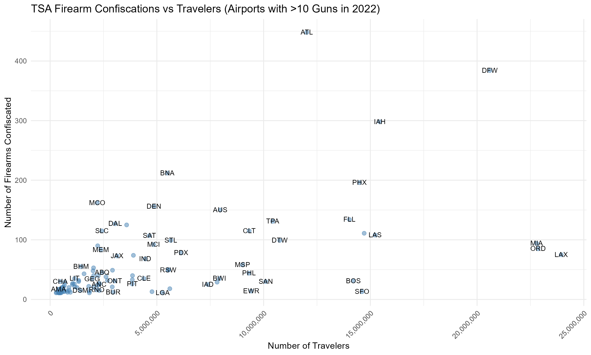

# TSA Screening Analysis: Firearm Confiscation Patterns and Airport Operations

## Project Overview
This project analyzes 2022 Transportation Security Administration (TSA) checkpoint traffic and firearm confiscation data to examine passenger throughput, airport-level confiscation patterns, and temporal variation in screening activity.

This was completed as a final exam project for DATA 2100 (Introduction 
to Data Analytics) at the University of Pennsylvania. I reframed the findings through a security analytics lens to explore how data analysis can support security operations, resource planning, and the identification of patterns.

**Original Assignment:** Analyze TSA checkpoint and firearm confiscation data 
to identify patterns and insights.

**Security Analytics Focus:** Examine firearm confiscation rates, passenger traffic patterns, and differences in screening activity across airports and checkpoints.
 

## Key Investigations

### 1. Airport-Level Firearm Confiscation Analysis
**Question:** Which airports recorded the highest firearm confiscation counts and rates relative to passenger throughput?

**Approach:**
- Aggregated annual passenger checkpoint traffic and firearm confiscation counts by airport.
- Merged the datasets, recording zero confiscations where appropriate.
- Calculated firearm confiscation rates per 100,000 travelers.
- Compared airports with more than 10 confiscations.
- Visualized confiscation counts against passenger throughput to identify airports that differed from the general pattern.

**Finding:** 
- Highest confiscation volume: Hartsfield–Jackson Atlanta International Airport (ATL) recorded 448 firearm confiscations in 2022, the highest total in the dataset.
- Highest confiscation rate: Orlando International Airport (MCO) recorded the highest confiscation rate among airports with more than 10 confiscations, at 7.34 per 100,000 travelers.
- Notable airport comparisons: ATL and Dallas/Fort Worth International Airport (DFW) stood out for their relatively high confiscation counts. Los Angeles International Airport (LAX) and Miami International Airport (MIA) had lower confiscation counts relative to their passenger volumes.

**Security Implication:** 
Comparing confiscation counts with passenger throughput provides a more informative view of airport-level patterns than absolute counts alone. High confiscation volumes may indicate greater screening workloads, while elevated confiscation rates can identify airports for further investigation.

However, confiscation counts and rates measure detected firearms rather than the total number of firearms brought through checkpoints or the underlying security risk at an airport. Differences may reflect passenger volume, traveler behavior, screening practices, or other factors. Additional evidence would be needed to determine the causes of the observed patterns.

### 2. Temporal Threat Pattern Analysis
**Question:** When do airports experience their highest average passenger throughput?

**Approach:**
- Built function to identify peak passenger throughput by airport
- Analyzed hourly checkpoint volume patterns
- Correlated temporal patterns with operational needs

**Findings:**
- Newark (EWR): Highest average passenger throughput at at 16:00 (4 PM)
- JFK: Highest average passenger throughput at 17:00 (5 PM)  
- LaGuardia (LGA): Highest average passenger throughput at 09:00 (9 AM)

**Security Implication:** These high-volume windows represent periods of increased exposure and may warrant proportional security staffing.

### 3. Checkpoint-Level Risk Assessment
**Question:** How is threat exposure distributed across airport terminals?

**Approach:**
- Aggregated daily traffic by checkpoint
- Analyzed traffic concentration patterns
- Identified high-volume security bottlenecks

**Finding:**
At Philadelphia International, Checkpoint D/E processes 3x more passengers than other checkpoints, creating a concentrated security exposure point.

### 4. Threat Volume Analysis
**Question:** Which airports detected the most security threats in 2022?

**Finding:**
Hartsfield-Jackson Atlanta (ATL) confiscated 448 firearms which was the highest in the nation.

## Technical Implementation

### Data Processing
- Cleaned and validated checkpoint names across airports
- Handled missing values and data inconsistencies

### Analysis Techniques
- Aggregation and grouping across temporal and geographic dimensions
- Statistical risk scoring 

### Tools & Technologies
- **R** (data manipulation, statistical analysis)
- **ggplot2** (data visualization)
- **dplyr** (data transformation)
- Base R (loops, functions, aggregation)

---

**Author:** Sakina Sarfraz   
**Institution:** University of Pennsylvania, BASc Mathematics & Data Analytics
