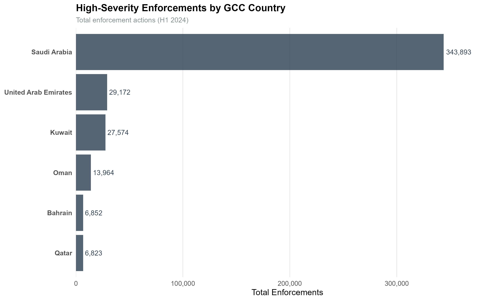
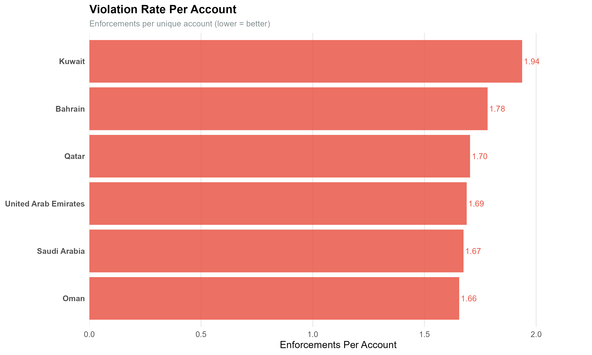
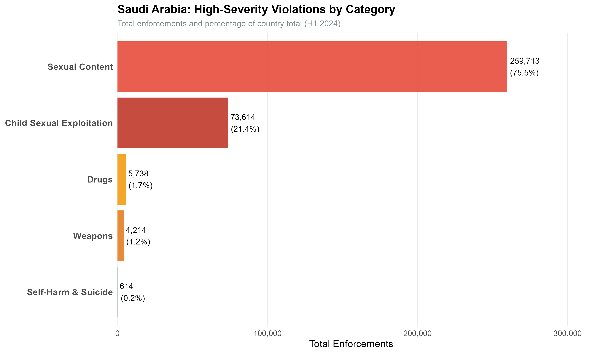
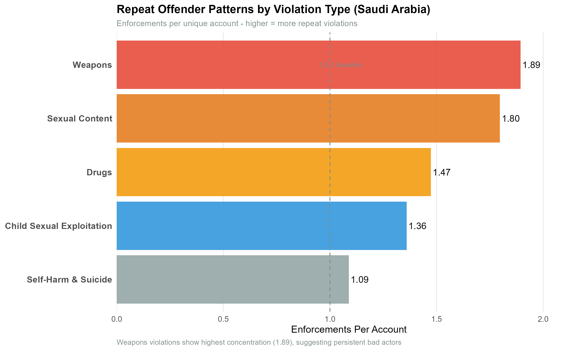
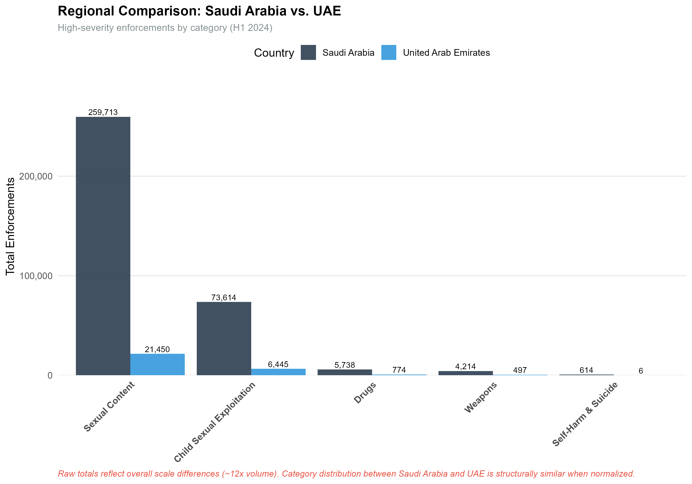
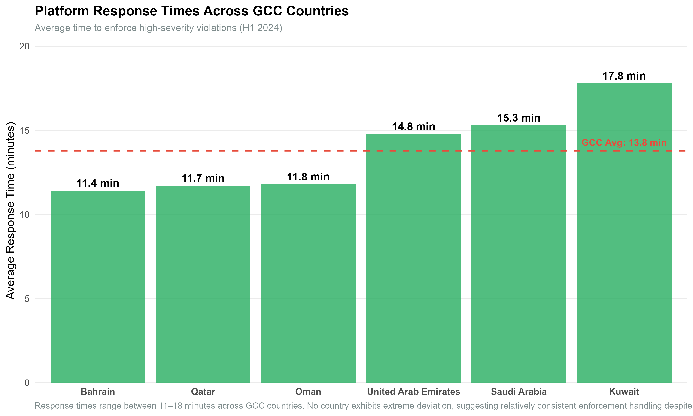

# Platform Safety: Geographic Threat Pattern Analysis

# Table of Contents:

1. Project Overview
2. Why Threat Analysis Matters
3. Part 1: Data Cleaning and Exploratory Analysis
4. Part 2: Exploratory Threat Pattern Data Analysis on Gulf Cooperation Council (GCC) Countries 


## Project Overview
This project analyzes data from the Snap Inc. H1 2024 Transparency Report which is publicly available online. Full analysis code available in repository. The data is analyzed in two parts:


- 1: Data Cleaning and Exploratory Analysis
**(This portion of the exploratory data analysis was originally a project of DATA 2100 (Introduction to Data Analytics) at the University of Pennsylvania and later expanded with security analysis)**
- 2: Exploratory Threat Pattern Data Analysis on Gulf Cooperation Council (GCC) Countries 

Dataset:
- **Source:** Snapchat Transparency Report (H1 2024)
- **Scale:** 22,988 enforcement records
- **Coverage:** 200+ countries, 15+ violation categories
- **Metrics:** Total enforcements, unique accounts impacted, median response times


## Skills Demonstrated In This Project

### Threat Analysis
- Geographic threat distribution analysis
- Threat categorization and prioritization
- Pattern recognition across threat types
- Enforcement effectiveness assessment
- Repeat offender detection methodology

### Data Analytics
- Data reshaping (long to wide format)
- Filtering and subsetting
- Geographic data analysis
- Statistical analysis (percentages, ratios, distributions)

### Technical Skills
- **R** (tidyr, dplyr, ggplot2)
- Data cleaning 
- Categorical data analysis
- Data visualization


Content Moderation:
- Detecting harmful content 
- Categorizing violations 
- Geographic threat patterns 
- Response time metrics 
- Enforcement effectiveness 

ULTIMATELY protecting users FIRST


## Part 1: Data Cleaning and Exploratory Analysis

### Data Tidying (The Hard Part)
This dataset required extensive cleaning before analysis was possible:

**Challenges faced:**
- Data was in long format (22,988 rows × 7 columns)
- Values stored as character strings instead of numeric
- Multi-level categorical structure (section → category → sub_category)
- Needed to reshape for country-violation analysis
- Missing values requiring NA handling

**Data transformation process:**
```r
# Convert character values to numeric
snapchat$value <- as.numeric(snapchat$value)

# Filter to relevant enforcement data
tands <- snapchat[snapchat$section == "Overview of Our T&S Enforcements" & 
                  snapchat$category == "Country", ]

# Remove redundant columns
tands$section <- NULL
tands$category <- NULL
tands$period <- NULL

# Rename for clarity
names(tands)[names(tands) == "sub_category_1"] <- "country"
names(tands)[names(tands) == "sub_category_2"] <- "type"

# Reshape from long to wide format
tands <- spread(tands, key = metric, value = value)
```

**Result:** Transformed messy transparency report data into analysis-ready format where each row represents a unique country-violation type pairing with all metrics accessible.

**Lesson learned:** Real-world security data is rarely clean. 


### 1. Enforcement Concentration and Potential Risk
**Question:** Which country and category have the highest number of enforcements per unique account impacted, and what might this indicate from a security perspective?

**Approach:**
Created new variable: Enforcements per unique account
- Divide the total number of enforcements by the total number of unique accounts impacted
- This metric helps identify country-category combinations where enforcement actions are concentrated among fewer accounts

**Finding:**
Paraguay's weapons category had the highest enforcement-per-account ratio, with 14 enforcements associated with one unique account, resulting in a ratio of 14:1. 

**Code:**
```r
tands$enforcements_per_account <- 
  tands$total_enforcements / tands$total_unique_accounts_enforced

max_row <- tands[which.max(tands$enforcements_per_account), ]
# Result: Paraguay, Weapons category, 14:1 ratio
```

**Security and Risk Implication:**
From a security perspective, the concentration of enforcements may be worth investigating for repeated policy violations. If the enforcement actions occurred across multiple incidents or at different times, the account's activity could warrant closer review. The ratio alone does not establish repeat offending, malicious intent, or the severity of the underlying risk.

This metric could serve as an initial risk-screening indicator by helping analysts identify cases for further investigation. Combining it with account-level enforcement histories, timestamps, violation severity, and incident details would provide a stronger basis for assessing whether the activity represents persistent policy violations or another enforcement pattern.


### 2. Geographic Concentration of Enforcement Activity
**Question:** What percentage of global enforcement comes from the United States of America?

**Approach:**
- Calculated total worldwide enforcements
- Isolated United States enforcement totals
- Summed enforcement actions attributed to the United States.
- Divided US enforcement actions by the worldwide total and multiplied by 100 to calculate the percentage of global enforcement.

**Finding:**
United States accounts for 38% of all global enforcement actions. This is a substantial concentration of enforcement activity in a single country. 

**Code:**
```r
total_worldwide <- sum(tands$total_enforcements, na.rm = TRUE)
us_total <- sum(tands$total_enforcements[tands$country == "United States"], 
                na.rm = TRUE)
us_percent <- (us_total / total_worldwide) * 100
# Result: 38.09%
```

**Security Implication:**
The concentration of enforcement activity in the United States may have implications for how moderation resources are allocated and how geographic enforcement patterns are interpreted. However, this figure measures the distribution of recorded enforcement actions, not the underlying prevalence of violations or the relative risk posed by users in different countries.

Several factors could contribute to this concentration, including differences in platform usage, the volume of content generated, detection capabilities, reporting behavior, and enforcement practices. The current analysis does not establish which factors explain the observed result.

From a security perspective, the finding provides a starting point for investigating geographic patterns in enforcement activity.


### 3. Threat Category Enforcement Analysis
**Question:** How many total enforcement actions did Snapchat take worldwide regarding weapons?

**Approach:**
- Filtered dataset to include only records classified under the Weapons category.
- Summed the total enforcement actions across all countries.
- Used the resulting total to assess the scale of enforcement activity associated with weapons-related content.

**Finding:**
Weapons-related content: 234,512 total enforcements worldwide across all countries.

**Code:**
```r
weapons_rows <- tands[tands$type == "Weapons", ]
total_weapons <- sum(weapons_rows$total_enforcements, na.rm = TRUE)
# Result: 234,512
```

**Security Implication:**
The volume of weapons-related enforcement actions is a relevant area to platform safety and content moderation. From a security perspective, this can help analysts understand the scale of enforcement activity associated with a particular policy category and inform decisions about moderation resources.

Enforcement volume alone does not establish the prevalence or severity of underlying threats. The total may reflect several factors, including the amount of content uploaded, the frequency of policy violations, detection capabilities, and enforcement practices.

Further analysis could compare weapons-related enforcement with other violation categories, examine trends over time, and investigate the distribution of enforcement actions across countries. These comparisons could help identify where enforcement activity is concentrated and where additional investigation or moderation resources may be warranted.


### 4. EU Weapons Enforcement: Response Time and Enforcement Concentration
**Question:** What is the median enforcement response time for weapons-related content, and what is the number of enforcements per unique account in the EU?

**Approach:**
- Filtered the dataset to include EU member states and records classified under the Weapons category.
- Examined the median enforcement turnaround time in minutes for each country.
- Compared enforcement turnaround times with enforcements per unique account to explore differences in response speed and enforcement concentration across EU countries.

**Finding:**
The analysis compares median enforcement turnaround times with enforcements per unique account for weapons-related content across EU countries. The visualization allows us to identify countries where enforcement actions are associated with shorter or longer response times and where enforcement activity is more concentrated among fewer accounts.

The specific median response time and highest enforcement-per-account value should be reported from the calculated results than inferred from the visualization alone.


**Visualization:**
```r
eu_countries <- c("Austria", "Belgium", "Bulgaria", "Croatia", "Cyprus", 
                  "Czech Republic", "Denmark", "Estonia", "Finland", "France", 
                  "Germany", "Greece", "Hungary", "Italy", "Latvia", "Lithuania", 
                  "Luxembourg", "Malta", "Netherlands", "Poland", "Portugal", 
                  "Romania", "Slovakia", "Slovenia", "Spain", "Sweden")

eu_weapons <- tands[tands$country %in% eu_countries & tands$type == "Weapons", ]

ggplot(eu_weapons, aes(x = median_turnaround_time_minutes, 
                       y = enforcements_per_account, label = country)) +
  geom_point(size = 1) +
  geom_text(vjust = -0.5, size = 2) +
  coord_flip() +
  labs(title = "EU: Enforcements per Account vs Median Turnaround Time (Weapons)",
       x = "Median Turnaround Time (minutes)",
       y = "Enforcements per Account")
```

**Security Implication:**
From a security perspective, response time is relevant to understanding how quickly potentially harmful content is acted upon, while enforcements per account can help identify concentrations of enforcement activity. Examining these measures together may highlight country-level patterns that warrant further investigation.

Shorter response times do not automatically demonstrate more effective moderation, and a high enforcement-per-account ratio does not independently establish a greater threat. Differences may reflect case complexity, enforcement procedures, reporting patterns, or the number of accounts involved. Further analysis of violation severity and content-level outcomes would be needed to evaluate moderation effectiveness.


## Key Takeaways

### Analytical Insights
**Enforcement concentration can reveal potential risk signals:** The 14:1 enforcement-per-account ratio for weapons-related content in Paraguay highlights a concentration of enforcement actions associated with one unique account. This may warrant further investigation into repeated violations, although the ratio alone does not establish persistent malicious behavior.
**Weapons enforcement represents a substantial moderation workload:** The 234,512 weapons-related enforcement actions recorded worldwide demonstrate the scale of enforcement activity associated with this category and its relevance to platform safety operations.
**Relative patterns provide additional context:** Ratios, percentages, and comparisons across countries and violation categories reveal patterns that absolute totals alone may obscure. These measures help identify areas for further investigation without automatically establishing threat severity.


### Technical Lessons
- **Data cleaning is essential:** Real-world security datasets can contain inconsistent labels, missing values, and other quality issues. Cleaning and validating the data are important for producing reliable analysis.
- **Calculated metrics can reveal hidden patterns:** Creating measures such as enforcements per unique account and a country's share of global enforcement helps transform raw data into interpretable findings that support further investigation.
- **Visualization clarifies complexity:** Geographic and categorical visualizations help communicate patterns across more than 22,000 records, making it easier to compare enforcement activity and identify potential areas of interest.

Enforcement volume does not directly measure threat prevalence, and enforcement concentration does not independently prove repeat offending. Combining metrics with additional contextual information produces more defensible security assessments.


# Part 2: Exploratory Data Analysis on Gulf Cooperation Council (GCC) Countries and Threat Pattern Analysis

## Personal Context 

Personal curiosity regarding social media applications and their threat reports was the main reason for this analysis. Snapchat is very popular amongst Gen Z. I wanted to explore how the platform reports and responds to potentially harmful content, particularly content that could pose safety risks to users. Is this platform safe for the younger generation?

To narrow these questions down, my focus went on the GCC because of my familiarity with the region and my interest in examining enforcement patterns across countries that share certain cultural, geographic, and institutional contexts. However, differences in population, platform usage, national laws, and reporting practices may influence the results.

After narrowing down to the GCC, I chose to analyze data from specific categories.

These categories are:
- Child Sexual Exploitation (CSE)
- Weapons
- Drugs
- Self-Harm & Suicide
- Sexual Content

These categories were selected because they may involve significant user-safety risks, policy violations, or, depending on the circumstances and jurisdiction, criminal conduct


Overall, I evaluated:
- Geographic distribution of enforcement activity
- Enforcement concentration among unique accounts
- Category-specific enforcement patterns
- Enforcement response times across GCC countries

The objective is to identify patterns in reported enforcement activity and explore their potential implications for platform safety and risk monitoring.


## Finding: 

### 1. GCC Enforcement Concentration Analysis

**Observation:**
Saudi Arabia has the highest total enforcement volume by far (343k) but not the highest rate. On the other hand, Kuwait has the highest repeated offender rate with approximately 1.93 enforcements per account

**Key Metric - Repeat Offender Rate:**
- Saudi Arabia: 1.67 enforcements per account
- UAE: 1.68 enforcements per account
- Qatar: 1.70 enforcements per account
- Kuwait: 1.93 enforcements per account
- Bahrain: 1.78 enforcements per account
- Oman: 1.65 enforcements per account

**Interpretation:**

The findings distinguish overall enforcement volume from enforcement concentration. Saudi Arabia's high total may reflect differences in population, platform activity, content volume, or enforcement practices. Kuwait's higher ratio indicates more enforcement actions per unique account on average, but does not independently establish a higher rate of repeat offending or greater security risk.

**Potential Explanations:**

Several factors could contribute to these differences, including population and platform user-base size, reporting behavior, content activity, and moderation practices. These remain hypotheses rather than conclusions supported by the enforcement counts alone. Additional data on active users, content volume, and account-level enforcement histories would help evaluate these possibilities.


**Potential Explanations:**

This pattern **could** reflect several factors:

1. **User Base Size:** Saudi Arabia has the largest population among GCC 
   countries (~35M vs. UAE ~10M, Qatar ~3M).

2. **Reporting Culture:** User reporting behavior may differ across countries, 
   with some markets more likely to flag violations.

3. **Platform Prioritization:** Snapchat may allocate more moderation resources 
   to larger markets.


#### 2. Violation Category Breakdown (Saudi Arabia)
**Analysis:** Examined which high-severity categories drive enforcement numbers.

**Finding:**
Top violation categories in Saudi Arabia:
1. Sexual Content:	259713 enforcements
2. Child Sexual Exploitation:	73614	enforcements
3. Drugs:	5738 enforcements
4. Weapons:	4214 enforcements
5. Self-Harm & Suicide:	614	enforcements

**Interpretation:**
Sexual content accounts for approximately 75% (259, 713 of 343,893) of Saudi Arabia’s high-severity enforcement volume, indicating that overall totals are structurally driven by this single category rather than evenly distributed across violation types.


#### 3. Regional Comparison: Saudi Arabia vs. UAE
**Analysis:** Compared two largest GCC markets across violation categories.

**Finding:**
                            Saudi Arabia | United Arab Emirates
Child Sexual Exploitation |	73614 (21%)  | 6445	(22%)
Drugs	                    | 5738	(1.66%)| 774	(2.65%)	
Self-Harm & Suicide	      | 614	  (0.17%)| 6		(0.02%)
Sexual Content	          | 259713 (75%) | 21450 (73%)		
Weapons	                  | 4214	(1.22%)| 497	(1.70%)

**Interpretation:**
Saudi Arabia and the UAE show similar enforcement-category distributions, with Sexual Content representing the largest share of recorded enforcement actions in both countries, followed by Child Sexual Exploitation.

Despite these similarities in composition, Saudi Arabia recorded approximately 11.8 times as many enforcement actions across the five selected categories as the UAE. This difference may reflect differences in population, platform activity, reporting, or enforcement practices. The available figures do not establish the cause.

The similarity in category composition is an interesting regional pattern, but further data would be needed to determine whether it reflects similar user behavior, platform enforcement practices, or other factors.


#### 4. Platform Response Time Analysis
**Analysis:** Measured average response times for high-severity violations by country.

**Finding:**
Average response times:
- Bahrain: 11.4 minutes
- Qatar: 11.7 minutes
- Oman: 11.7 minutes
- United Arab Emirates: 14.7 minutes
- Saudi Arabia: 15.2 minutes
- Kuwait: 17.7 minutes

**Interpretation:**
The reported averages fall within a narrow range of approximately 11–18 minutes. This provides a comparison of enforcement turnaround times across GCC countries.

From a security perspective, response time is relevant because delays in acting on harmful content may affect the period during which content remains accessible. However, average turnaround time alone does not establish moderation effectiveness or whether high-severity cases were appropriately prioritized. Differences may also reflect case complexity, category composition, and the way response times are calculated.

Further analysis could compare turnaround times within each category and examine medians, percentiles, and the proportion of cases exceeding a defined response-time threshold. These measures would provide a more detailed assessment of response consistency and potential operational bottlenecks.


---

## Visualizations

### GCC Total Enforcements


### GCC Enforcements per Unique Account.


### Saudi Category Breakdown


### Saudi Arabia: Enforcements per Unique Account.


### Saudi vs UAE Comparison


### GCC Response Times



**Author:** Sakina Sarfraz   


